# 👋 Olá! Eu sou o Pedro Augusto

**Engenharia da Computação · Desenvolvimento de software · Inteligência Artificial**

Sou estudante de Engenharia da Computação no **CEFET-MG**. Desenvolvo aplicações desktop e web, com foco em IA aplicada, análise de dados e interfaces para problemas reais.

Meus projetos conectam desenvolvimento de software, experimentação em aprendizado de máquina e colaboração em equipe — de um assistente desktop com IA a ferramentas de análise e indicadores de saúde.

---

## 🔥 Tecnologias e Linguagens

---

## 🚀 Projetos em destaque

### 🤖 JARVIS — Assistente desktop com IA
Projeto pessoal **privado, em desenvolvimento**, para Windows. Integra gerenciamento de tarefas locais por conversa com IA, dashboard e assistente flutuante, com persistência em SQLite.

**Tecnologias:** Tauri, React, TypeScript, Rust e integração com Gemini.  
O código-fonte permanece privado.

### 📈 [LIS-ANALYSIS](https://github.com/Jottynha/LIS-ANALYSIS)
Ferramenta em Python para analisar arquivos de simulações ATP, extrair estatísticas e gerar planilhas e gráficos. Conta com interface gráfica e recursos para edição de parâmetros de simulação.

**Minha participação:** desenvolvimento colaborativo, incluindo melhorias na interface e no fluxo de edição de parâmetros ATP.  
**Tecnologias:** Python, pandas, NumPy, Matplotlib e openpyxl.

### 🏥 [Dashboard SEMUSA](https://github.com/Matheus-Emanue123/Dashboard-SEMUSA)
Projeto colaborativo do CEFET-MG com a Secretaria Municipal de Saúde, voltado ao acompanhamento de indicadores de saúde. **Em desenvolvimento e validação**, com parte das telas ainda baseada em dados demonstrativos.

**Minha participação:** estrutura inicial do repositório, governança, componentes do frontend e integração de importação e visualização de dados materno-infantis.  
**Tecnologias do projeto:** React, NestJS e PostgreSQL.  
**Contribuições incorporadas:** [estrutura inicial](https://github.com/Matheus-Emanue123/Dashboard-SEMUSA/pull/17), [importação de planilhas](https://github.com/Matheus-Emanue123/Dashboard-SEMUSA/pull/77) e [integração dos resultados](https://github.com/Matheus-Emanue123/Dashboard-SEMUSA/pull/83).

### 💻 Outros projetos públicos

| Projeto | O que você encontra |
| --- | --- |
| [Diabetes Classification](https://github.com/PedroAugusto08/Diabetes-Classification) | Experimento acadêmico em Python com pré-processamento de dados, comparação de KNN, SVM e árvore de decisão e validação cruzada. |
| [FinanceTracker](https://github.com/PedroAugusto08/FinanceTracker) | Aplicação web de finanças pessoais com receitas, despesas, gráficos, autenticação e persistência com Firebase. |
| [Job Interview Kombat](https://github.com/PedroAugusto08/Job-Interview-Kombat) | Jogo educacional colaborativo para praticar entrevistas de emprego em inglês, desenvolvido com HTML, CSS e JavaScript no CEFET-MG. |

---

## 📊 Estatísticas do GitHub

---
## 🐍 Meus rastros no GitHub!

Veja minha jornada de contribuições no estilo "Snake Game"!

---

## 📫 Contato
  
📧 Email: pedroaugustomoura70927@gmail.com
